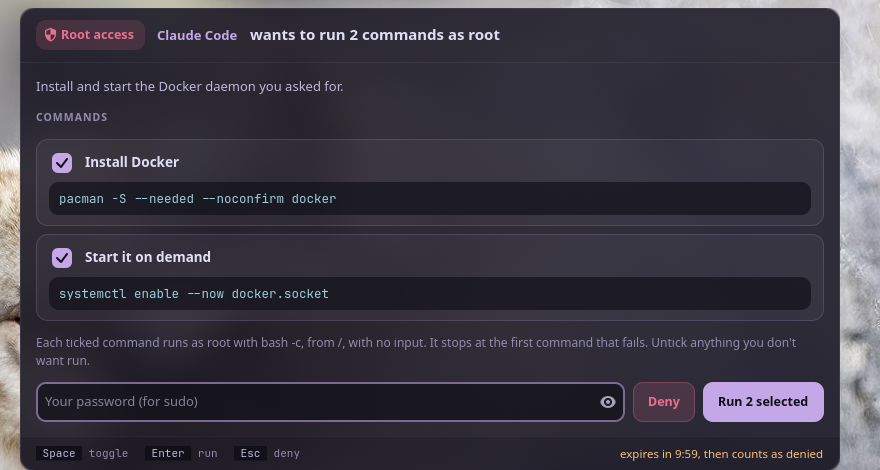

<p align="center">
  <picture>
    <source media="(prefers-color-scheme: dark)" srcset="assets/banner-dark.svg">
    <source media="(prefers-color-scheme: light)" srcset="assets/banner-light.svg">
    
  </picture>
</p>

<p align="center">
  <b>Let AI agents ask for the commands they can't run themselves, as root or as you, and run only the ones you approve.</b><br>
  One window: every command and why, marked ROOT or YOU, a tick to allow it, your password once for the root ones. The agent gets the results as JSON.
</p>

<p align="center">
  <a href="https://github.com/Theyashsawarkar/anumati/actions/workflows/ci.yml"></a>
  <a href="https://github.com/Theyashsawarkar/anumati/releases"></a>
  <a href="LICENSE"></a>
  
  
</p>

<p align="center">
  
</p>

> *Anumati* (अनुमति) is Sanskrit for "permission, consent": nothing runs
> as root without yours.

An AI coding agent (Claude Code, Codex, Aider, Gemini CLI, anything that can
run a shell command or speak MCP) regularly needs something done as root:
install a package, enable a service, edit a file in `/etc`. The usual
answer is to copy sudo commands between the agent and a terminal.
anumati replaces that: the agent sends the commands, each with a reason; a
window shows them on your desktop; you untick what you don't want, type
your password once, and the ticked commands run. The agent gets every
command's output and exit code back.

The same goes for commands that don't need root but that the agent can't
run itself: its sandbox blocks the network or a folder, or you've set it to
ask first. The agent marks those `"as": "user"`; they show in the same
window with a **YOU** badge instead of **ROOT**, run as you with a click (no
password), and come back the same way.

## Contents

- [Features](#features)
- [Install](#install)
- [What you see](#what-you-see)
- [For agents: sending a request](#for-agents-sending-a-request)
- [For agents: reading the result](#for-agents-reading-the-result)
- [For agents: over MCP](#for-agents-over-mcp)
- [Telling your agent about it](#telling-your-agent-about-it)
- [What's recorded](#whats-recorded)
- [Security](#security)
- [How it works](#how-it-works)
- [Troubleshooting](#troubleshooting)
- [Contributing](#contributing)
- [License](#license)

## Features

- **You see exactly what runs**: every command as it will run, under the
  agent's one-line reason for it, and a checkbox on each.
- **Root or you, never mixed up**: every command carries a ROOT (red) or
  YOU badge and its number in the run order; YOU commands also show the
  user and folder they run in. The password is asked for only when a ROOT
  command is ticked ([ADR 8](docs/adr/0008-commands-as-you.md)).
- **One password for the batch**, typed into a window the agent didn't
  start and can't read. No sudo timestamp is left behind (`sudo -k`).
- **Structured results**: per-command state (`ok`, `failed`, `skipped`,
  `declined`), exit code, stdout and stderr, as JSON on stdout, with
  meaningful exit codes.
- **Two ways in**: JSON on stdin (or `--cmd`/`--why` pairs) for anything
  that runs shell commands, and an MCP server (`--mcp`) with one tool,
  `request_commands` (also under its old name, `request_root_commands`).
- **Refuses tricks**: requests with control characters or invisible
  Unicode (bidi overrides, zero-width) are rejected, so what you read is
  what runs; every command needs a reason; at most 50 per request.
- **Audit trail**: a root-only log of everything that ran, and your own log
  of every request, denied ones included.
- **Expires**: an unanswered request counts as denied after 10 minutes.
- **Answer from your phone**: with [ekatva](https://github.com/Theyashsawarkar/ekatva)
  running, the request also shows on your paired phone; approving there
  (your fingerprint, your password) is the same as typing it here
  ([ADR 7](docs/adr/0007-answer-from-the-phone.md)).

## Install

Requirements: Linux with a Wayland desktop (sway, Hyprland, GNOME, KDE…)
and systemd's user manager, `sudo`, Python 3.11+, PyGObject, GTK 4,
libadwaita, and libnotify (`notify-send`).

```sh
git clone https://github.com/Theyashsawarkar/anumati ~/.local/share/anumati
~/.local/share/anumati/install.sh          # asks for sudo once
anumati --why "Test" --cmd "id"            # the window opens; approve it
```

`install.sh` installs everything **root-owned** (`/usr/local/bin/anumati`,
`/usr/local/lib/anumati/`), so an agent running as your user can't change
what the window shows or what it runs. On Arch it installs the dependencies
too; elsewhere install them first (Debian/Ubuntu: `python3-gi gir1.2-gtk-4.0
gir1.2-adw-1 libnotify-bin`; Fedora: `python3-gobject gtk4 libadwaita
libnotify`).

```sh
~/.local/share/anumati/install.sh --check       # what differs from this clone
git -C ~/.local/share/anumati pull && ~/.local/share/anumati/install.sh   # update
~/.local/share/anumati/install.sh --uninstall
```

It used to be called `vayu-elevate`; the installer keeps that name as a
link to `anumati`, so agents and notes that still use it keep working.

## What you see

A window opens with everything the agent asked for: each command exactly as
it will run, its reason, a checkbox, and a badge saying how it runs:
**ROOT** (as root, from `/`) or **YOU** (as you, in the folder shown under
it). The top bar says how many of each. Untick anything you don't want,
type your password if any ROOT command is ticked, press **Run** (or Enter).
A request with only YOU commands has no password field. The ticked commands
run in order, stopping at the first failure, and each card shows its result. If
they all succeed the window closes by itself; if one fails it stays open
with the error.

It looks like the rest of the desktop: [Vyom](https://github.com/Theyashsawarkar/vyom)'s
panels, in your [varna](https://github.com/Theyashsawarkar/varna) theme when
you have one. The theme's colours are used only if everything stays readable
(see Security), so a theme can change tints, never hide anything.

| Key | Action |
|---|---|
| `Enter (password field or Run)` | Run the selected commands (as root and as you) |
| `Space` | Toggle the focused command |
| `Esc` | Cancel the root request (deny everything; closes the window after a run) |
| `Enter (after a failed run)` | Close the window |

Closing the window, Deny or Esc means nothing runs. Three wrong passwords
end the request. A request nobody answers expires after 10 minutes.

## For agents: sending a request

Send a JSON request on stdin. It blocks until the user answers (up to 10
minutes), then prints a JSON result.

```sh
anumati <<'EOF'
{
  "requester": "Claude Code",
  "reason": "Install Docker and start it on demand, as you asked.",
  "commands": [
    {"cmd": "pacman -S --needed --noconfirm docker", "why": "Install Docker"},
    {"cmd": "systemctl enable --now docker.socket", "why": "Start Docker when something connects to it"},
    {"cmd": "docker compose up -d", "why": "Start the project's services",
     "as": "user", "cwd": "/home/me/project"}
  ]
}
EOF
```

One-off form: `anumati --requester "Claude Code" --why "Reload udev rules" --cmd "udevadm control --reload"`
(repeat `--why`/`--cmd` pairs for more; add `--as user` and `--cwd DIR` to
run them all as you). `anumati --schema` prints the request and result JSON
Schema.

Rules for the commands:

- `"as"` says how each runs, and the user sees it on the card:
  - `"root"` (the default, so 1.x requests work unchanged): as root, from
    `/`. Needs the user's password. `cwd` isn't allowed.
  - `"user"`: as the user, in `cwd` (an absolute path; default: their
    home), approved with a click. For commands that don't need root but
    that you can't run yourself (a sandbox, a permission rule). They run
    outside your sandbox, from the window, with the session's environment
    filtered to an allowlist (`HOME`, `USER`, `LANG`, `PATH` without
    world-writable folders, the Wayland/D-Bus/SSH-agent sockets…), not
    yours: pass anything else on the command line.
- Each runs with `bash -c`, with **no stdin and no tty**:
  anything that prompts fails or hangs until its 30-minute limit. Use
  `pacman --noconfirm`, `apt -y`, `cp -f` and the like.
- They run in order and stop at the first non-zero exit; the rest are
  reported as `skipped`.
- Every command needs a `why`: one plain line the user decides from.
- At most 50 commands, 8000 characters each; no control characters or
  invisible Unicode.
- In a ROOT command `~` is root's home: write `/home/<user>/...` in full.

Ask for exactly what's needed, explain each command honestly, don't re-send
a denied request unless the user asks, and treat a declined command as the
user's answer.

## For agents: reading the result

```json
{
  "status": "completed",
  "message": "Ran the approved commands.",
  "approved": [0, 1],
  "declined": [],
  "results": [
    {"index": 0, "command": "pacman -S --needed --noconfirm docker", "why": "Install Docker",
     "as": "root", "cwd": "/", "decision": "approved", "state": "ok", "exit_code": 0, "stdout": "...", "stderr": "",
     "duration": 14.2, "timed_out": false, "truncated": false}
  ]
}
```

| `status` | Meaning |
|---|---|
| `completed` | At least one command was approved and they ran: check each result's `state` |
| `denied` | The user pressed Deny, Esc or closed the window; nothing ran |
| `timeout` | No answer within 10 minutes; nothing ran |
| `auth_failed` | Wrong password three times; nothing ran |
| `error` | Bad request or the tool itself failed; see `message` |

| `state` | Meaning |
|---|---|
| `ok` | Ran, exit code 0 |
| `failed` | Ran, non-zero exit code |
| `skipped` | Approved, but an earlier command failed |
| `declined` | The user unticked it |
| `not_run` | The request was denied, timed out or failed before running |

Output is capped at 512 KB per stream (`truncated: true` when cut).

| Exit code | Meaning |
|---|---|
| `0` | Every command was approved and succeeded |
| `1` | An approved command failed |
| `2` | Bad request or tool error |
| `3` | Nothing ran (denied, timeout, wrong password) |
| `4` | Some commands were declined; the approved ones succeeded |

## For agents: over MCP

`anumati --mcp` is an MCP server (stdio) with one tool,
`request_commands`, taking the same request object and returning the
result as text and `structuredContent`. It's also listed under its 1.x
name, `request_root_commands` (the same tool: commands without `"as"` run
as root), so existing setups keep working.

```sh
claude mcp add --scope user anumati -- anumati --mcp      # Claude Code
```

```json
{
  "mcpServers": {
    "anumati": {"command": "/usr/local/bin/anumati", "args": ["--mcp"]}
  }
}
```

The call blocks until the user answers, up to 10 minutes. If your client
times out tool calls sooner, raise its limit (Claude Code: the
`MCP_TOOL_TIMEOUT` environment variable, in milliseconds).

## Telling your agent about it

Add a few lines to the agent's global instructions (Claude Code:
`~/.claude/CLAUDE.md`; Codex: `~/.codex/AGENTS.md`; Gemini CLI:
`~/.gemini/GEMINI.md`):

```markdown
- Commands you can't run yourself: don't ask me to paste them into a
  terminal. Send them to `anumati` (JSON on stdin: requester, reason,
  commands: [{cmd, why, as, cwd}]; see `anumati --help`): `"as": "root"`
  for anything that needs root, `"as": "user"` (with `cwd`) for the rest,
  like a command your sandbox blocks. I approve them in a window; you get
  the results. Respect declined commands; never retry a denied request
  unasked.
```

## What's recorded

Every command that ran as root, with its exit code, goes to
`/var/log/anumati.log`: root-only, so the agent can't edit it. Every
request, denied ones included, goes to your own
`~/.local/state/anumati/requests.jsonl`, with each command's `as` and
`cwd` (YOU commands are only in this one).

```sh
sudo tail -n 20 /var/log/anumati.log | jq .
tail -n 5 ~/.local/state/anumati/requests.jsonl | jq .
```

## Security

anumati is a **consent gate**: nothing runs as root unless you see it and
type your password, and nothing runs as you unless you see it and press Run.

| Guarantee | How |
|---|---|
| The agent never sees your password | It's typed into the approval window: a separate process the agent didn't start (a transient systemd user service, with a clean environment) and can't inspect (`PR_SET_DUMPABLE=0`). |
| What runs is what you saw | The window and the root-side runner are root-owned files; the window holds the request in memory once shown; Python runs isolated (`-I`); your GTK styling can't hide part of it (the window uses root-owned XDG dirs); the theme's colours are read as plain `#rrggbb` only and used only while every text stays readable, else anumati's own ([ADR 6](docs/adr/0006-themed-but-never-hidden.md)); invisible or direction-changing characters are refused. |
| No leftover access | sudo runs with `-k` both times: no cached credentials for anything else. |
| ROOT and YOU can't be confused | Each card says which, in its own colour, with its number in the run order; YOU cards show the user and folder. A command without `"as"` is ROOT, never the reverse; root commands always run from `/`. |
| A YOU command runs only what you saw | It runs from the window, not the agent, with `bash -c` (no login shell, so no rc file), in an allowlisted environment taken from the session's systemd user manager, not the agent: no `BASH_ENV`, `LD_PRELOAD` or exported functions, and a `PATH` without relative or world-writable folders ([ADR 8](docs/adr/0008-commands-as-you.md)). |
| Answering from the phone changes none of this | The phone's answer, through ekatva's end-to-end encrypted link, ticks the commands visibly and fills the password field; then the same check and runner. The window sends nothing secret out, and finds ekatva by your uid, not the agent's environment ([ADR 7](docs/adr/0007-answer-from-the-phone.md)). |

What it **can't** do: protect you from a program that is actively malicious
and already running as your user. Such a program could draw a lookalike
window to collect your password, or tamper with the systemd user manager the
window starts from; that's true of every password prompt on a Linux desktop,
polkit's included. Use anumati with agents you trust to ask honestly, and
read each command before you approve it. Report security problems privately:
[SECURITY.md](SECURITY.md).

## How it works

1. `anumati` rejects bad requests (no `why`, more than 50 commands, hidden
   characters), writes the request to `$XDG_RUNTIME_DIR/anumati/<id>/`
   (mode 0700) and starts the window with `systemd-run --user` and `env -i`:
   a transient service, not a child of the agent.
2. The window (`lib/dialog.py`, GTK 4 / libadwaita) reads the request once
   into memory and shows it. You untick, type your password, press Run.
3. If a ROOT command is ticked, it checks the password with
   `sudo -S -k true`. Then it goes through the ticked commands in order:
   each run of consecutive ROOT commands goes to
   `sudo -S -k -- python3 -I runner.py`, with the password and those
   commands on its stdin (nothing is written to disk); each YOU command
   runs in the window's own process (`lib/userrun.py`).
4. The runner (`lib/runner.py`) runs each command with `bash -c` from `/`,
   no stdin, a minimal environment, 30 minutes max each, and appends each
   to `/var/log/anumati.log`. YOU commands get the same limits. The first
   failure, either kind, skips the rest.
5. The window writes `result.json`; `anumati` prints it and exits.

## Troubleshooting

- **No window appears.** anumati needs a graphical session: `WAYLAND_DISPLAY`
  (or `DISPLAY`) and systemd's user manager. From SSH or a plain TTY it
  returns `status: error`.
- **"Wrong password" though it's right.** Your user must be allowed to use
  `sudo` (the `wheel` group on Arch, `sudo` on Debian).
- **A command hangs, then times out.** It's waiting for input: add a
  non-interactive flag (`--noconfirm`, `-y`).
- **The window looks unstyled or tiny.** Install libadwaita; on a tiling
  compositor, float it: sway `for_window [app_id="^io\.github\.theyashsawarkar\.Anumati$"] floating enable`.

## Contributing

Bug reports, ideas and pull requests are welcome: see
[CONTRIBUTING.md](CONTRIBUTING.md), and [CHANGELOG.md](CHANGELOG.md) for
what changed in each release. Changes to what runs as root get extra
scrutiny; security reports go privately ([SECURITY.md](SECURITY.md)).

anumati comes from [Vayu](https://github.com/Theyashsawarkar/vayu), a
keyboard-driven Wayland desktop, and works on any Linux desktop on its own.

## License

[MIT](LICENSE)
